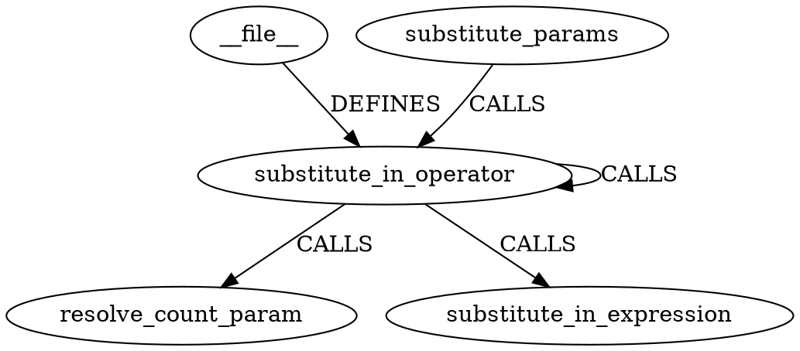
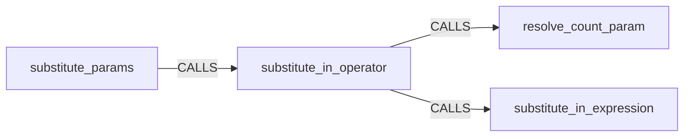

# obrain viz — sous-graphe de démonstration (consommateur web)

Sous-graphe **réel** extrait du store `engine_idx.obrain` (banc-obrain), centre
`substitute_in_operator`, 1 hop — même vérité que le banc de pertinence LLM :
`2404 -> 2404 [label="CALLS"]` (récursivité) est présent dans le DOT ci-dessous.

## Fichiers

| Fichier | Contenu |
|---|---|
| [`sub.json`](sub.json) | json-graph v1 (source de vérité, 5 nœuds / 5 arêtes) |
| [`sub.svg`](sub.svg) | rendu Graphviz réel (WASM `@viz-js/viz`) — à ouvrir dans le navigateur |
| [`viewer.html`](viewer.html) | vue interactive **sans dépendance** : clic sur un nœud → voisins en évidence |

## DOT (rendu natif par les artefacteurs markdown/GUI)



## Mermaid (rendu natif dans n'importe quel markdown : GitHub, Obsidian, GUI)



## Commandes de régénération

```bash
obrain viz subgraph <engine_idx.obrain> substitute_in_operator \
  --hops 1 --limit 12 --as json > sub.json
obrain viz subgraph <engine_idx.obrain> substitute_in_operator \
  --hops 1 --limit 12 --as dot  > sub.dot
# puis DOT -> SVG via @viz-js/viz (WASM) :
#   node --input-type=module -e "const {instance}=await import('@viz-js/viz');
#   const viz=await instance();process.stdout.write(viz.renderString(dot,{format:'svg'}));"
```
